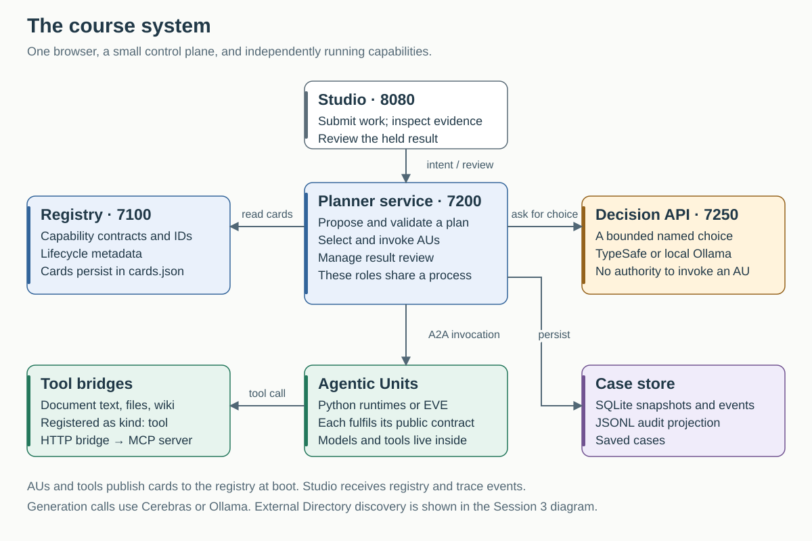
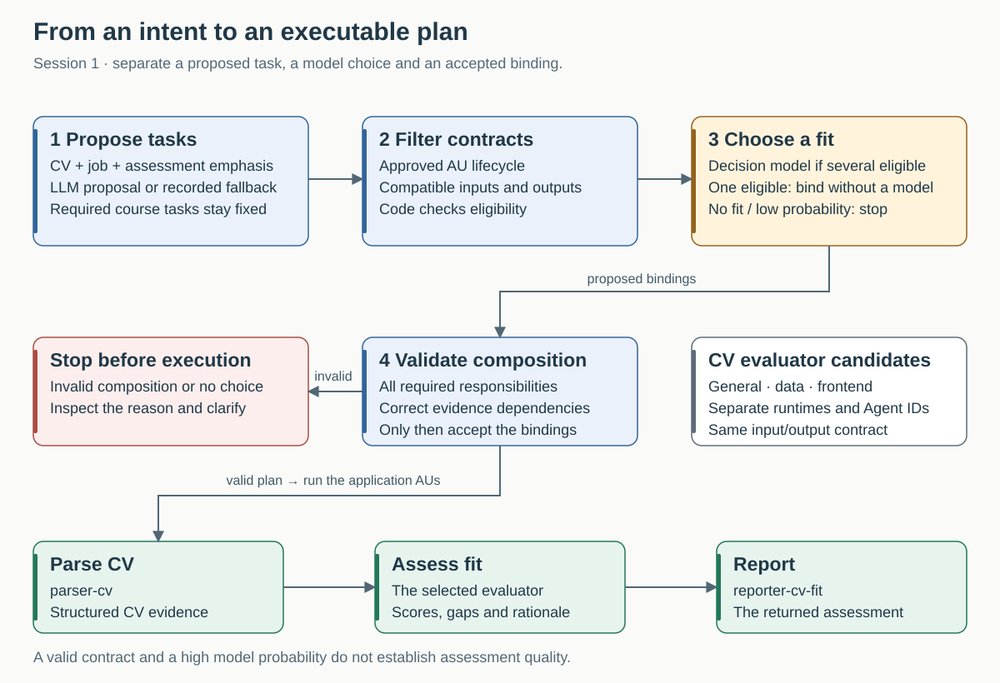
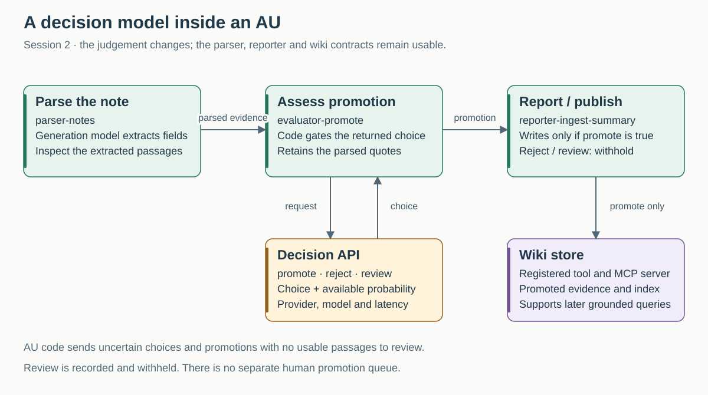
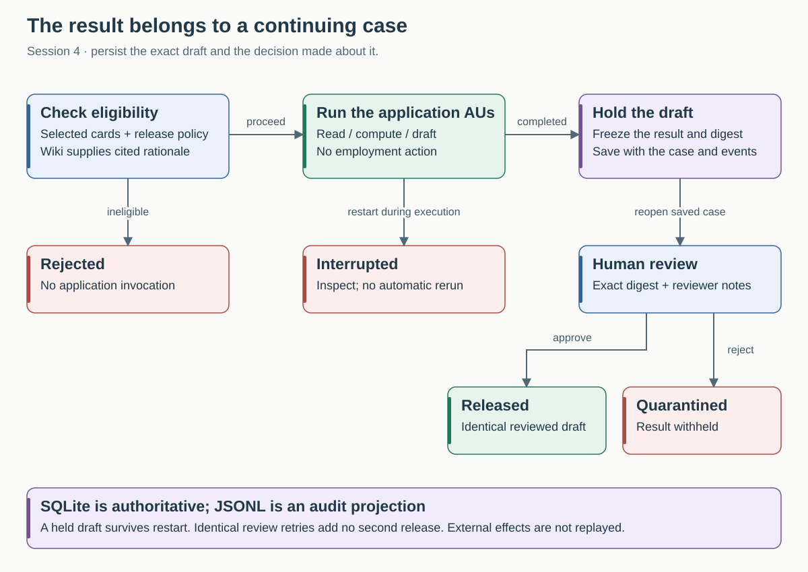

# How the course system works

This guide describes the **October implementation on `main`**, with `.env.revised` present. Start with the [setup and launcher table](pre-work/01-revised-model-access.md#start-and-stop), then use this page alongside Studio. The existing technical reference remains in [`system/ARCHITECTURE.md`](../system/ARCHITECTURE.md).

The course builds one estate across four examples: assess a CV, curate a wiki, adopt an EVE interviewer, then review a persistent business result. A capability is a job the system can ask for; an Agentic Unit is the runtime responsible for fulfilling its contract. A model is one possible implementation component inside that boundary.

## Components and responsibilities

| Component | What it actually does here | What to inspect |
|---|---|---|
| **Studio** | Accepts input, forwards intents/reviews, displays registry changes, decisions, results and traces. It does not plan the work. | `http://localhost:8080`; capability summary/JSON, AU selection and run review |
| **Runtime registry** | A real HTTP service. Receives cards from running AUs/tools, persists them in `cards.json`, lists capabilities and broadcasts updates. | `http://localhost:7100/list`; each card's ID, purpose, inputs, outputs and lifecycle |
| **Planner service** | Constructs a bounded task plan, allocates AUs, validates composition, orchestrates calls and controls result release. These distinct responsibilities share one Python process. | `http://localhost:7200/healthz`; proposal source, allocation evidence and accepted plan |
| **Decision service** | Calls TypeSafe's typed-choice API, or the explicitly unscored Ollama baseline. Returns a choice and available provenance. The caller decides whether to accept it. | `http://localhost:7250/healthz`; choice, eligible alternatives, provider/model and latency in the trace |
| **Python AUs** | Parser, evaluator and reporter codebases deployed with particular cards, instructions and Agent IDs. Specialists are separate evaluator runtimes. | The selected card and its `instructions.md`, `skills_hash`, inputs, outputs and signals |
| **EVE AU** | The learner's TypeScript agent running in the real EVE runtime, behind a course-owned adoption bridge. | Native EVE at `http://localhost:7310`; adopted card at `http://localhost:7311/.well-known/agent-card.json` |
| **Tool bridges** | Deterministic capabilities for files, document extraction and wiki storage. Registered HTTP bridges call the local MCP implementations. | `kind: tool`; tool invocations within the AU trace |
| **Case store** | SQLite snapshots and ordered events, used to restore runs and commit exact-result review. | Saved case, status, result digest and review; `system/services/planner/traces/cases.sqlite3` |
| **AGNTCY Directory** | A real Directory daemon, CLI and course helper in one container, started for the discovery lab. It stores and finds portable OASF records, outside the request execution path. | Published record, content ID, search/pull result and comparison with a local card |

These URLs refer to the machine running the course. On Spark use your configured connection or forwarding; `localhost` on a different laptop is a different machine. Directory exposes loopback port 8890 for the CLI and [8891 for its upstream catalogue](http://localhost:8891); its CLI and helper run inside the container through `directory.sh/.bat`. The helper reaches `registry:7100` on the course Docker network. Directory records are separate from Studio's runtime-registry pane and persist under `.course-data/directory`. Open exported/pulled `.course-data/*.json` files to inspect the full OASF descriptions. The current plain course records have no integration modules, so they do not appear in the v1.8.0 browser catalogue; see [viewing OASF descriptions](sessions/session-03-eve/DIRECTORY.md#view-the-oasf-descriptions).

The registry is deliberately small: lifecycle actors are seeded and registration defaults to approved. This makes the mechanics visible; it does not implement independent publisher verification or an enterprise approval workflow. Likewise the planner is real executable planning/orchestration code, but is not itself a separately registered Planner AU.

## Session 1: proposing work and choosing an AU

The CV intent contains document paths and an **assessment emphasis**. The planner reads registry cards and proposes the required parsing, assessment and reporting tasks. In Sessions 1–2 the default strategy is `hybrid`: a generation model proposes a plan; invalid or failed proposals use an explicit, recorded course fallback. The workflow catalogue already defines the required responsibilities. This is not unrestricted discovery of arbitrary business processes.

The allocation code compares each proposed task with a reference contract. It filters for approved AU lifecycle, required inputs and compatible outputs. With one eligible AU it binds directly. With several, it asks the decision model to choose among them, including `no_suitable_capability`. A low probability, no fit, unavailable provider or invalid response stops allocation before application work. The hosted probability threshold is a teaching policy, not a calibrated quality guarantee.

The entire resolved composition then passes a further check: every required responsibility remains, and each task consumes the right upstream evidence. Only afterwards does the trace record accepted bindings. Execution is sequential in this teaching implementation, even though the plan contains explicit dependencies.

The general, data and frontend evaluators have compatible public contracts and different instructions. Choosing the data evaluator changes the runtime doing the assessment, not the parser or reporter contract. Compare actual results before concluding that the choice improved quality. The course records observations; it does not automatically train the selector or maintain a measured-quality marketplace.

**Inspect in Studio:** proposal source → eligible candidates → returned choice → composition validation → accepted AU → actual output. Continue with the [CV exercise](sessions/session-01-cv-fit/DECISIONS.md).

## Session 2: the decision is the AU's main model output

`parser-notes` uses generation to extract a note. `evaluator-promote` uses the decision service for `promote`, `reject` or `review`. Code constructs the existing promotion output from the parsed fields. Retained passage quotes are not rewritten by a second generation call. This preserves the parser's text; checking that extraction faithfully represents the original source is still necessary.

`reporter-ingest-summary` calls the wiki store only when promotion is true. Uncertain material is recorded and withheld; there is no separate human promotion queue. The query workflow remains `parser-query → evaluator-wiki-query → reporter-answer`, with retrieval and ranking over the stored passages.

This is a separate use of a decision model from AU allocation: the judgement is the core work of this AU. Continue with the [wiki exercise](sessions/session-02-wiki/DECISIONS.md).

## Session 3: adopting another framework and using external discovery

The course uses real EVE and AGNTCY components, with explicit integration code between them and AOA. EVE supplies the agent framework and runtime. AGNTCY Directory stores portable descriptions. The course bridge adds the local capability contract, identity, invocation surface and trace boundary. The runtime registry supplies the candidates used by the planner.

Read [Adopting EVE with AGNTCY Directory](sessions/session-03-eve/ADOPTION.md) before the lab. It explains the actual invocation, the three different descriptions, the proof at each boundary and the work still required to adopt an externally owned agent. Then follow [native authoring](sessions/session-03-eve/WALKTHROUGH.md) and the [Directory exercise](sessions/session-03-eve/DIRECTORY.md).

## Session 4: a result that survives the process

Before application invocation, the deterministic governance evaluator checks the selected cards, use context and release policy. The wiki supplies inspectable policy evidence. Once eligible, the CV AUs produce a draft; SQLite stores that exact output and its digest. A planner restart restores a held draft for review without regenerating it.

Review binds to the exact result digest and requires notes. Approval releases the same payload; rejection quarantines it. Snapshot and review/release events commit in one SQLite transaction. An identical retry returns the recorded outcome; a conflicting review is rejected. JSONL is regenerated from the stored events for the original audit tools.

A restart during execution marks the case interrupted. The implementation cannot know whether an external effect occurred, so it does not automatically replay that invocation. The course uses a single planner process, not a distributed workflow engine or Cloudflare Durable Objects deployment. Its configured reviewer ID is a classroom actor label, not authenticated reviewer identity. Continue with the [durable case exercise](sessions/session-04-compliance/DURABLE-CASES.md).

## What changes between sessions

| Session | Task proposal | AU allocation | Main addition | Result handling |
|---|---|---|---|---|
| 1 · CV | Hybrid LLM proposal with recorded fallback | Contract checks then decision model when several eligible | General/data/frontend evaluator choice | Normal completion; saved case and trace |
| 2 · wiki | Hybrid LLM proposal with recorded fallback | Same allocation path | Decision-powered promotion and wiki tools | Conditional publication; saved case and trace |
| 3 · EVE | Fixed course plan | Same allocation path after adoption | Real EVE runtime, adoption bridge, optional Directory lab | Interview questions; saved case and trace |
| 4 · compliance | Fixed course plan | Same allocation path, followed by governance eligibility | Evidence AUs and exact-result review | Held employment result, release/quarantine and restart recovery |

Sessions 3 and 4 deliberately fix task planning to keep attention on adoption and governance. They can still use TypeSafe for AU allocation. `PLANNER_STRATEGY`, `ALLOCATION_MODE` and `DURABLE_CASES` control different things; inspect `/healthz` rather than inferring behaviour from a single model setting.

## Files that explain the implementation

| Question | Source |
|---|---|
| What starts in each session? | [`revised-compose.sh`](../scripts/revised-compose.sh) and its [Windows counterpart](../scripts/revised-compose.bat); [`docker-compose.revised.yml`](../system/docker-compose.revised.yml) |
| Where are the task plans and execution loop? | [`planner.py`](../system/services/planner/planner.py) |
| Where are eligibility, choice and composition checked? | [`allocation.py`](../system/services/planner/allocation.py) |
| What actually calls TypeSafe or Ollama? | [`decision.py`](../system/services/decision/decision.py) |
| What builds the wiki promotion result? | [`decisions.py`](../system/agents/_base/decisions.py) |
| What survives restart? | [`case_store.py`](../system/services/planner/case_store.py) |
| How do capabilities register? | [`registry.py`](../system/services/registry/registry.py) and the [AU scaffold](../system/AGENTS.md) |
| Where is third-party adoption implemented? | [EVE adoption guide](sessions/session-03-eve/ADOPTION.md#follow-the-integration-in-code) |

Source links work in the repository or a local editor. Studio serves the learner `course/` documentation and diagrams; it does not expose arbitrary repository source files.

For the verification already performed and its limits, see the [validation record](REVISED-VALIDATION.md). These diagrams describe code and configuration, not a claim that every diagrammed path has been rehearsed on both learner laptops.
