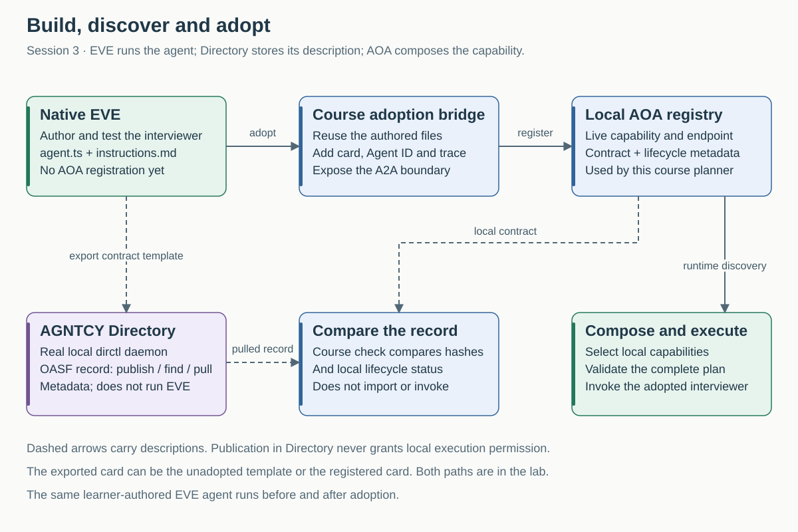
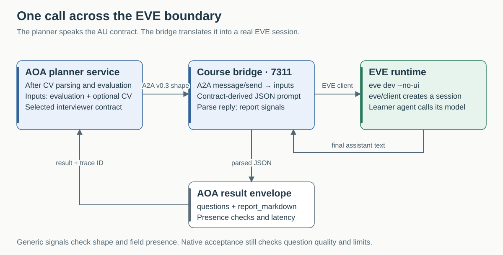

# Adopting EVE with AGNTCY Directory

The business already has CV parsing and assessment. It now needs interview questions based on that assessment. We build that capability in **EVE**, accept it in its own development environment, and then make it usable by the existing AOA system. From revised Session 3 onwards, **AGNTCY Directory supplies the planner's AU discovery**. All running AUs are published, including the EVE interviewer; local adoption and lifecycle checks still control which discovered capabilities may be selected.

This is the course's concrete test of framework independence. The Python planner can use a TypeScript agent running in a third-party framework because the integration boundary describes the work, inputs, outputs and invocation. It does not require rewriting the agent in the Python scaffold.

Read the [system map](../../ARCHITECTURE.md) first. Follow the [native walkthrough](WALKTHROUGH.md) for the actual agent code and acceptance inputs; use the [Directory lab](DIRECTORY.md) for publish/search/pull commands. This page explains the responsibilities, artefacts and evidence connecting those exercises.

## What is real, and what belongs to this course?

| Part | What we use | What this establishes |
|---|---|---|
| EVE framework | Real `eve` package, pinned to **0.17.1**, running its CLI, development runtime and client API in Docker | We can author and run an agent independently of the AOA scaffold |
| Interviewer agent | Learner-authored `agent.ts`, `instructions.md` and channel files | A separately implemented capability can fulfil the same outward contracts as the Python AUs |
| Adoption bridge | Course-owned JavaScript under `system/agents-eve/runtime/adapter/` | The integration work required to expose EVE as an AU is visible and inspectable |
| AGNTCY Directory | Real **v1.8.0** `dirctl` daemon and client in Docker, using the pinned upstream binary | A description can be stored, indexed, searched and retrieved through external discovery infrastructure |
| OASF record | **1.0.0** record exported by the course helper with a skill classification and contract digest | A portable declaration can be related to the local capability contract |
| Runtime registry | Course HTTP service with persisted cards and seeded lifecycle actors | Local adoption and lifecycle remain authoritative; enterprise publisher identity/approval is simplified |

We adopt a learner-owned agent built with third-party technology. We do not download an unknown vendor agent from Directory or demonstrate cross-company trust. This distinction keeps the demonstrated interoperability separate from the further work involved in adopting an externally owned service.

EVE's upstream project describes its framework and agent tooling; AGNTCY documents a broader infrastructure family including Directory, OASF, identity, messaging and observability. This course exercises only the named subset. See the [EVE repository](https://github.com/vercel/eve), [Directory v1.8.0 release](https://github.com/agntcy/dir/releases/tag/v1.8.0), [Directory local deployment](https://dir.agntcy.org/latest/dir/dir-deployment-local/) and [AGNTCY documentation](https://docs.agntcy.org/). The repository pins govern the lab; current upstream examples may differ.

## Three boundaries to demonstrate

**Native acceptance:** Does the agent do its bounded job in EVE? The learner supplies an evaluation and checks that the agent produces five grounded, concise interview questions in the required JSON shape. No AOA registration is needed for that test.

**Adoption:** Can the accepted implementation fulfil an AU contract in this estate? The course bridge publishes the capability, translates the invocation into an EVE turn and returns the result. The same authored files remain in the workshop. The implementation now has a registered outward boundary.

**Discovery and comparison:** Can the planner find the adopted capability through AGNTCY? Directory stores the OASF record and actual A2A card; a course adapter publishes and retrieves them. The planner checks the current local binding and approval before allocation. The manual helper comparison remains available. Neither a matching declaration nor discovery proves identity, behaviour or permission.

## Who owns which responsibility?

| Responsibility | EVE | AGNTCY Directory in this lab | Course AOA components |
|---|---|---|---|
| Agent behaviour, model wiring and native sessions | Runs the learner agent | — | Bridge delegates a turn to EVE |
| Native developer workflow | `eve init`, `eve info`, `eve dev` | — | Docker supplies the pinned environment |
| Portable description and discovery | — | Stores/indexes OASF records; returns a content ID | Adapter publishes runtime records; planner checks retrieved records against adopted bindings |
| Local capability contract and Agent ID | — | An annotation can reference them | Bridge stamps and publishes; registry persists |
| Outward invocation | EVE client/session interface | Not in the invocation path | Bridge exposes the course A2A surface |
| Task allocation and composition | — | Does not select the task executor here | Planner reads local cards, allocates, validates and invokes |
| Behavioural acceptance | Native test inputs and observed replies | A record does not test behaviour | Learner checks the adopted result and trace |
| Result review and case recovery | EVE has its own session state | Directory has record storage | The course planner owns the business case; Session 4 teaches exact-result review |

Keeping these responsibilities distinct allows a framework or discovery service to change without assuming it also supplies the enterprise's execution policy.

## Follow one invocation

1. The planner searches AGNTCY, pulls the OASF records and matches their bindings against current approved local cards. It resolves `interviewer-questions` as the final step in the CV/interview workflow and records the Directory content ID. The inputs are the prior assessment and optional structured CV.
2. It sends an A2A JSON-RPC `message/send` request to the adopted card's endpoint. The request carries the capability ID and shared `trace_id`.
3. The bridge extracts inputs and builds a JSON-in/JSON-out message using the capability card. It does not implement the interviewer's reasoning.
4. The bridge's `eve/client` creates an EVE session and sends the message. The actual EVE runtime executes the learner agent using the configured model. A fresh native session is created for each invocation; this lab does not teach cross-request interview memory.
5. The bridge reads the final assistant text, parses JSON and returns `questions` and `report_markdown` in the AOA result envelope, with basic presence and latency signals. The planner records the response and Studio displays the result.

The generic bridge is deliberately limited. Its automatic signals check JSON shape and field presence, not every word limit, the exact five-question requirement or semantic quality. Those remain native and adopted acceptance checks. AU-level trace submission is best-effort; planner request/response records and AU trace events should both be inspected rather than assuming perfect tracing.

The outward bridge uses the **A2A v0.3 message/card shape**. It is not an A2A v1 conformance implementation. The course adapter is integration code we own, not a claim that EVE ships an AOA adapter.

## Three descriptions of the same capability

| Description | Purpose | Where to find it |
|---|---|---|
| **AOA capability card** | Local task contract: capability ID, purpose, typed inputs/outputs, constraints and signals. Runtime identity, endpoint and provenance are stamped on publication. | Authored YAML in `system/agents-eve/workshop/capability-card.yaml`; registered JSON at `http://localhost:7100/find?id=interviewer-questions` |
| **A2A Agent Card** | Describes the adopted agent's outward protocol endpoint and advertised capabilities. | `http://localhost:7311/.well-known/agent-card.json` |
| **OASF record** | Portable discovery description: name, schema version, skills and course annotations. | Exported JSON under `.course-data/`, then stored and retrieved through Directory |

The OASF exporter maps `interviewer-questions` to question generation and parser capabilities to fact extraction. Evaluators and reporters have explicit v1.0.0 mappings for inference, quality evaluation, retrieval, compliance assessment, question answering or summarisation, alongside their precise local contracts. These are declared jobs, not performance or legal-certification claims. Automatic publications embed each runtime's actual A2A Agent Card. The manual template export remains available without that module. `aoa/capability-id` and the digest annotations are course conventions, not a universal AOA acceptance mechanism supplied by OASF.

The comparison hash covers `id`, `version`, `kind`, `purpose`, `inputs`, `outputs` and `constraints`. It does **not** hash the model, instructions, implementation code, endpoint, identity or measured performance. A matching hash establishes equality of those selected declaration fields. Inspect `skills_hash` and actual behaviour separately.

The planner additionally requires `aoa/binding-sha256`, covering those contract fields plus `agent_id`, `identity`, `endpoint`, `a2a_endpoint`, `agent_card_url` and `provenance` (including the instructions hash when present). It also checks the A2A module's endpoint/skill and current local lifecycle. This prevents a stale publication or external endpoint from replacing an adopted binding. It does not verify publisher identity or establish behavioural quality. No current publication means no new run; there is no local discovery fallback in Sessions 3–4.

Directory's content ID identifies the published record. It is distinct from the contract digest inside that record and from the local Agent ID. None of those identifiers alone proves that a running service belongs to a trusted supplier.

## The learner sequence and its evidence

| Stage | Action | Evidence to retain |
|---|---|---|
| 1 · Prepare | Use the [launcher table](../../pre-work/01-revised-model-access.md#start-and-stop); pre-build Session 3 images | Pinned EVE image and configured model route |
| 2 · Author | Start native EVE; follow the [walkthrough](WALKTHROUGH.md) through `eve init`, provider configuration and `eve dev` | Learner files; native output for the supplied synthetic input |
| 3 · Accept natively | Check five questions, field/word limits, grounding and no hiring decision | The observed reply and any failure/correction |
| 4 · Adopt | Exit the native shell and run `session3-adopt.sh` or `.bat` | Healthy bridge, local card and automatic publication of the running AU estate |
| 5 · Discover | Browse AGNTCY and pull an actual runtime record through the [Directory lab](DIRECTORY.md) | OASF with actual A2A card, Directory content ID, retrieved record |
| 6 · Compare | Run the helper's `check` command | Matching local contract/lifecycle fields; `execution_authorised: false` |
| 7 · Compose | In Studio choose **CV fit + interview**, using the same CV/JD fixtures | AGNTCY discovery event, EVE content ID, accepted binding, A2A request and five returned questions |
| 8 · Challenge | Change a copy of the discovery record's contract hash; check it again | A mismatch, with no change to local adoption or lifecycle state |

In the revised course, a specialist evaluator may be selected before the EVE step. Inspect that accepted binding. The Session 3 task plan is fixed to keep attention on the adoption boundary; AU allocation still uses the revised contract/decision path.

EVE and Directory both run through Docker on Windows. Use the same Windows checkout and Command Prompt for `session3-adopt.bat` and `directory.bat`; no separate WSL checkout or host Python is needed. The shell launcher provides the same Directory operations on macOS/Linux. Directory records and exported files remain in `.course-data`, and the course stop/log scripts include the Directory container. The [original native-host route](NATIVE-DIRECTORY.md) remains available as an alternative.

## Adopting an externally owned agent

The working lab establishes that framework-specific execution can sit behind a reusable contract, and that an external discovery implementation can carry the description. A real supplier adoption adds decisions that this local lab does not make:

| Decision | What the adopter would need to establish |
|---|---|
| Ownership and identity | Who operates the endpoint, how that identity is verified, and who can approve or revoke adoption |
| Contract mapping | Whether the supplied inputs, outputs, failure behaviour and side effects meet the local task contract; whether a translator is needed |
| Runtime access | Credentials, delegated scope, permitted tools/data, network access and where the model processes data |
| Fitness | Tests using representative cases, observed failures, quality, latency and total cost; a skill label is only a declaration |
| Operation | Timeout/retry policy, version changes, continuing-case ownership and evidence when a remote invocation has an unknown outcome |
| Replacement | Whether another implementation can satisfy the same contract without changing callers, and what regression checks are required |

These are the concrete adoption questions to take into another framework integration. The EVE bridge demonstrates one mechanism; it is not a universal adapter for arbitrary third-party agents. A different framework may offer an existing protocol boundary, need an HTTP translation layer, or require a different session/lifecycle adapter.

## Follow the integration in code

Repository links below work in GitHub or an editor; Studio only serves the learner documentation.

| Responsibility | File |
|---|---|
| Pinned third-party dependencies | [`runtime/package.json`](../../../system/agents-eve/runtime/package.json) and its lockfile |
| Learner/runtime mounts and endpoints | [`docker-compose.session3-lab.yml`](../../../system/docker-compose.session3-lab.yml) |
| Generic adoption entry point | [`generic-boot.mjs`](../../../system/agents-eve/runtime/adapter/generic-boot.mjs) |
| A2A translation, output parsing and signals | [`serve.mjs`](../../../system/agents-eve/runtime/adapter/serve.mjs) |
| Real EVE process and client/session calls | [`eve.mjs`](../../../system/agents-eve/runtime/adapter/eve.mjs) |
| Card stamping and registry publication | [`card.mjs`](../../../system/agents-eve/runtime/adapter/card.mjs), [`registry.mjs`](../../../system/agents-eve/runtime/adapter/registry.mjs) |
| Interviewer contract | [`interviewer-questions.yaml`](../../../system/agents-eve/runtime/templates/interviewer-questions.yaml) |
| Pinned Directory container and persistent data | [`Dockerfile`](../../../system/services/directory/Dockerfile), [`docker-compose.directory.yml`](../../../system/docker-compose.directory.yml) |
| Cross-platform Directory commands | [`directory.sh`](../../../scripts/directory.sh), [`directory.bat`](../../../scripts/directory.bat) |
| Optional native-host Directory installation | [`directory-install.sh`](../../../scripts/directory-install.sh) |
| OASF export, CLI calls and local comparison | [`directory-lab.py`](../../../scripts/directory-lab.py) |

## What has been verified?

The [21 October validation](../../REVISED-VALIDATION.md) records real EVE scaffolding, adoption, a direct five-question response and a complete CV-to-EVE composition on Spark. It also records real Directory storage, indexing, search, retrieval and a local contract comparison. Those observations support the integration claim.

Fresh Mac/Windows walkthroughs and Lewis's timed rehearsal remain separate acceptance steps. The lab does not establish cross-company trust, production readiness, universal A2A conformance, or deployment of the rest of AGNTCY. The useful evidence is the working call across the boundary and the artefacts that let us inspect it.
